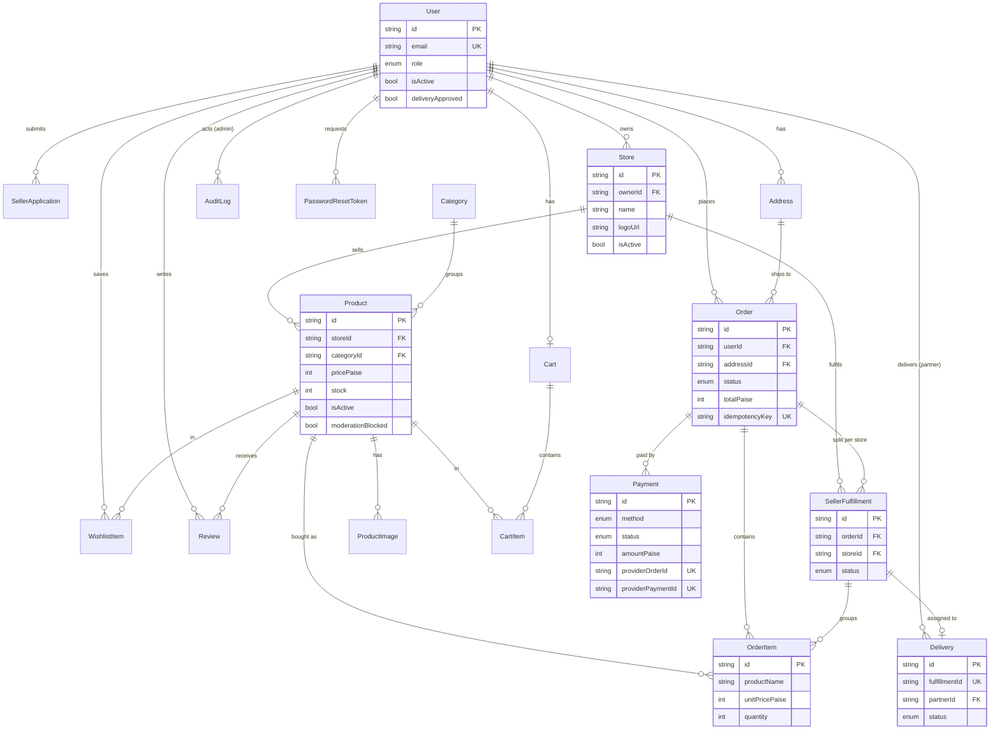

# Locora database ER diagram
Source of truth: `services/api/prisma/schema.prisma`. Money is stored as integer **paise**. View this Mermaid diagram on GitHub or at mermaid.live.

**Multi-seller strategy:** one customer `Order` (the money the customer pays) is split into one `SellerFulfillment` per store. Each seller only sees and changes their own fulfillment. `OrderItem` stores the price and name at purchase time, so later price edits never change old orders.
**Anti-duplicate constraints:** `Order.idempotencyKey`, `Payment.providerOrderId`, `Payment.providerPaymentId`, `Delivery.fulfillmentId`, `Review(userId, productId)` are unique.
